<p align="center">
  
</p>

<p align="center">
  <b>Open-source, self-hosted newsletters that reach the inbox.</b><br>
  Send through your own Amazon SES, Postmark, Mailgun, SendGrid, Resend, Postal or any SMTP server.
</p>

<p align="center">
  <a href="https://github.com/hostrepute/reputecast/actions/workflows/ci.yml"></a>
  <a href="https://github.com/hostrepute/reputecast/releases/latest"></a>
  <a href="LICENSE"></a>
</p>

<p align="center">
  <a href="#quick-start">Quick start</a> ·
  <a href="docs/deploy/README.md">Self-hosting</a> ·
  <a href="docs/api/README.md">API</a> ·
  <a href="CONTRIBUTING.md">Contributing</a> ·
  <a href="https://github.com/hostrepute/reputecast/releases">Releases</a>
</p>

ReputeCast is a newsletter and email-marketing platform you run yourself. It
sends through the providers you already use, checks every campaign for
deliverability problems before it goes out, and pauses a send when bounces or
complaints climb. **Every feature is free:** there is no paid edition and no
seat or workspace limit.

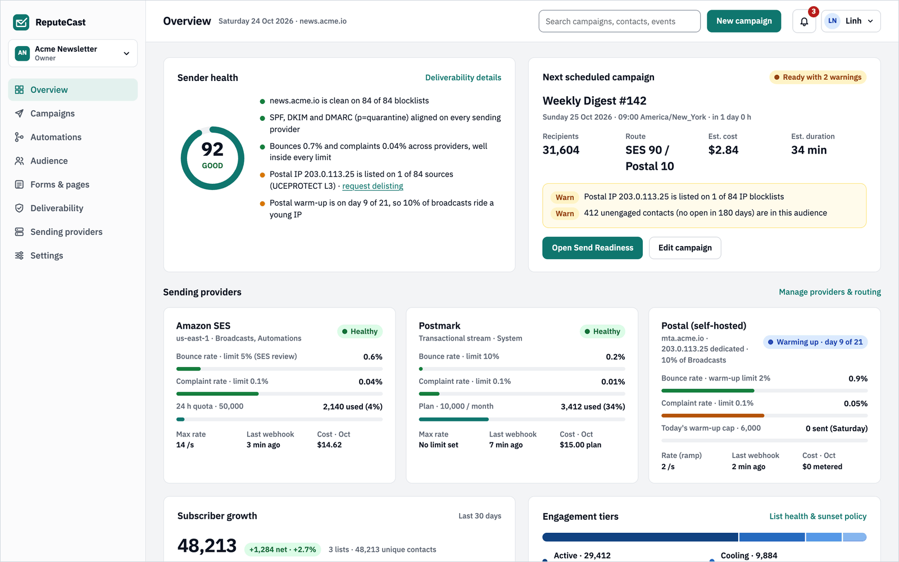

## Features

- **Send Readiness.** Every campaign gets a verdict before it goes out (Ready,
  Ready with warnings or Blocked), with evidence and a fix for each finding:
  blocklists, SPF/DKIM/DMARC, content, links, Gmail and Yahoo bulk-sender
  rules, audience quality and routing.
- **Guarded sending.** Live progress per mailbox provider and per sending
  provider. The whole send, or just one route, pauses when bounces or
  complaints cross your thresholds.
- **Bring your own providers.** Amazon SES, Mailgun, SendGrid, Postmark,
  Resend, SparkPost, Mailjet, Brevo, Azure Communication Services, Postal and
  any SMTP server, several at once: routing per stream and mailbox provider
  (found from MX records, so Google Workspace counts as Gmail), sticky
  weighted splits, failover only to a provider that passes its checks,
  warm-up enforced as mail goes out, and one shared suppression list that
  pushes only what applies to all mail. Or
  [write an adapter](docs/adapters.md).
- **Composer.** A drag-and-drop MJML builder with a Write mode for people who
  just want to type, personalization chips with fallbacks, a code view,
  device and inbox previews (or real renders through your own Litmus or
  Mailgun Inspect), A/B variants each checked on its own, a brand kit with
  synced header and footer, comments and review links, autosave that
  survives a crash, and inline deliverability warnings.
- **Honest analytics.** Human, privacy-protected (Apple Mail) and machine
  opens counted apart, with the open rate of the opens you can measure;
  clicks settled against security scanners before they count; complaint
  rates only where mailbox providers report them; A/B winners decided by
  sample size and significance; a click map per variant; each number
  compared with your last issues; results per mailbox provider and per
  sending provider.
- **Transactional email.** Templates written in the composer, a send, batch
  and render API with idempotency keys, an SMTP relay, a message log,
  category unsubscribes and delivery alerts, on a stream that fails over
  automatically and goes before broadcasts.
- **SMS, web push and WhatsApp.** SMS campaigns with routing by country,
  consent per list, keywords and quiet hours; web push with a prompt designer;
  WhatsApp through Meta's Cloud API with templates and the 24-hour window.
  Each channel is also an automation step.
- **Audience and automations.** Contacts, segments (builder or read-only SQL),
  engagement tiers and a sunset policy; visual automation flows with live
  stats.
- **Forms and public pages.** Signup forms with double opt-in, a preference
  center, one-click unsubscribe and a public archive.
- **More ways to engage readers.** Recurring and RSS digests, conditional
  content, polls and surveys, contact scoring with bands and decay, growth
  sources per list, address verification and inbox placement tests.
- **Grow and earn.** A referral program, recommendations with partner links,
  paid subscriptions through Stripe (tiers, upgrade pages, paid-only content),
  offers, gift subscriptions, sponsors and revenue attribution.
- **Website, pages and products.** A publication website with posts, members,
  a meter and a paywall; landing, sales and webinar pages; a shop for digital
  products.
- **Content in several languages.** Language versions of campaigns,
  automation emails and transactional templates; forms and public pages per
  language; each contact's language, checked in Send Readiness.
- **The app in your language.** English and Vietnamese, with each member's own
  language and region format ([add a language](docs/i18n/translating.md)).
- **Accessibility checks.** In the composer with one-click fixes, in the
  color picker, and in Send Readiness with a workspace policy.
- **Deliverability.** Domain and IP health, provider account health,
  blocklists and DMARC. Connect [HostRepute](https://hostrepute.com) to add
  80+ blocklists, Google Postmaster Tools and Microsoft SNDS.
- **Teams and access.** Roles with granular permissions, send approvals,
  passkeys and TOTP, OIDC single sign-on and an immutable audit log.
- **Agencies.** Client workspaces run from one instance: staff assignments,
  client sign-off, a shared template library, and usage and rebilling per
  client.
- **AI assistant, with your own key.** Suggestions shown as diffs in the
  composer, for segments and in reports, through the model provider and
  monthly cap your workspace sets.
- **Imports that keep consent** from Brevo, Mailchimp, MailerLite, listmonk,
  Keila, CSV or XLSX.
- **Integrations.** Zapier, Make and n8n apps, a WordPress plugin, and Shopify
  and WooCommerce stores ([integrations](docs/integrations/hub.md)).
- **API, webhooks and MCP.** A REST API described by OpenAPI 3.1, signed
  webhooks, and an MCP server for AI agents that pass the same permission
  checks as people.

## Screenshots

<table>
  <tr>
    <td width="50%" valign="top">
      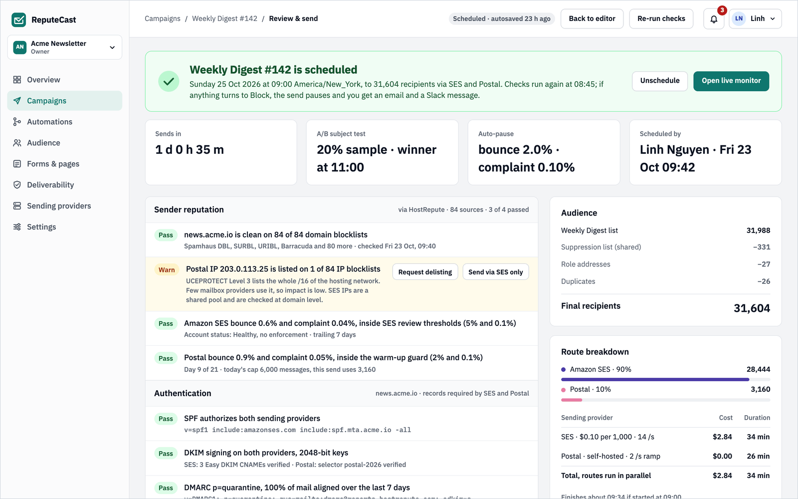
      <b>Send Readiness</b> checks reputation, authentication, content and routing before you send.
    </td>
    <td width="50%" valign="top">
      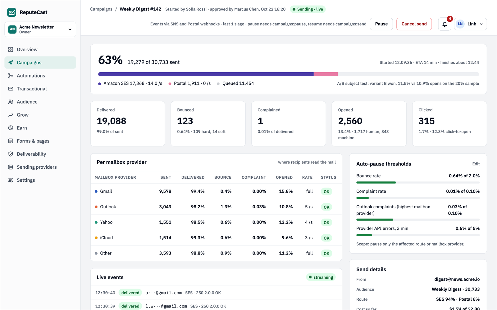
      <b>Live monitor</b> with results per mailbox provider and auto-pause thresholds.
    </td>
  </tr>
  <tr>
    <td width="50%" valign="top">
      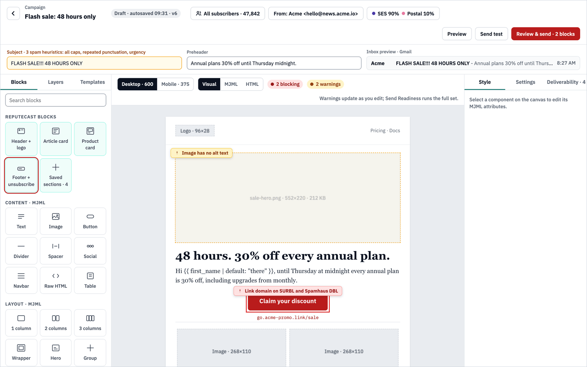
      <b>Composer</b> that flags deliverability problems while you write.
    </td>
    <td width="50%" valign="top">
      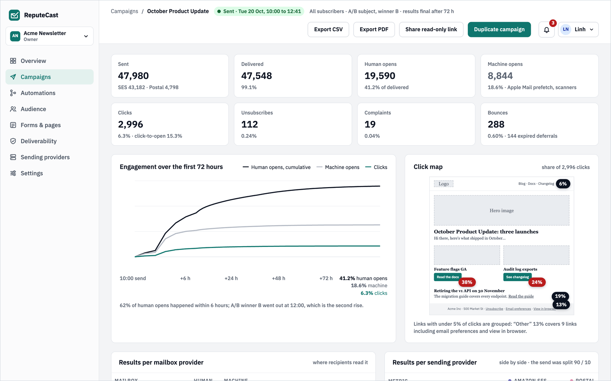
      <b>Reports</b> that count human and machine opens apart.
    </td>
  </tr>
  <tr>
    <td width="50%" valign="top">
      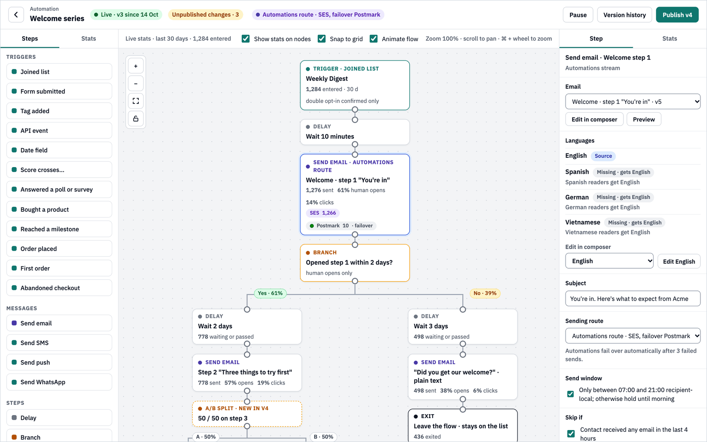
      <b>Automations</b> as visual flows with live stats on every step.
    </td>
    <td width="50%" valign="top">
      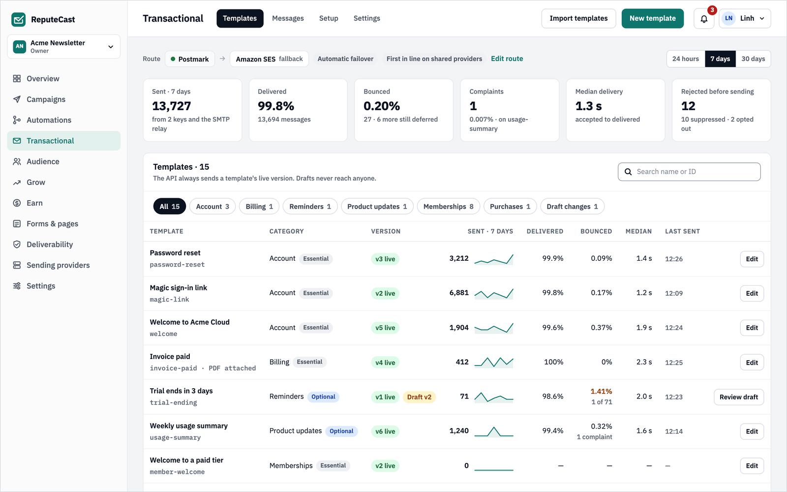
      <b>Transactional email</b> with templates, a send API and delivery per template.
    </td>
  </tr>
  <tr>
    <td width="50%" valign="top">
      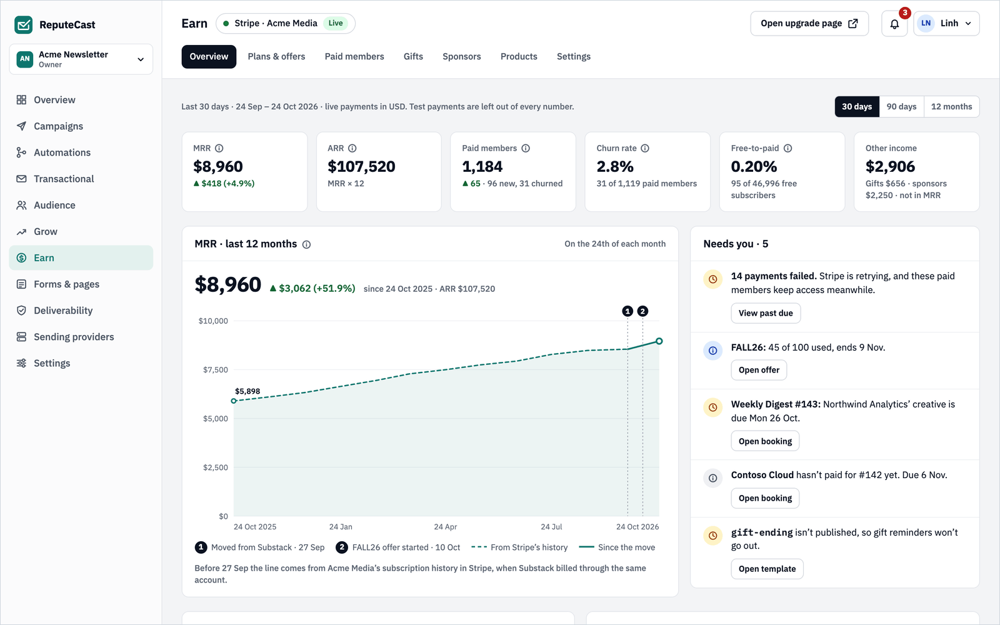
      <b>Earn</b> with paid subscriptions, revenue and what needs you.
    </td>
    <td width="50%" valign="top">
      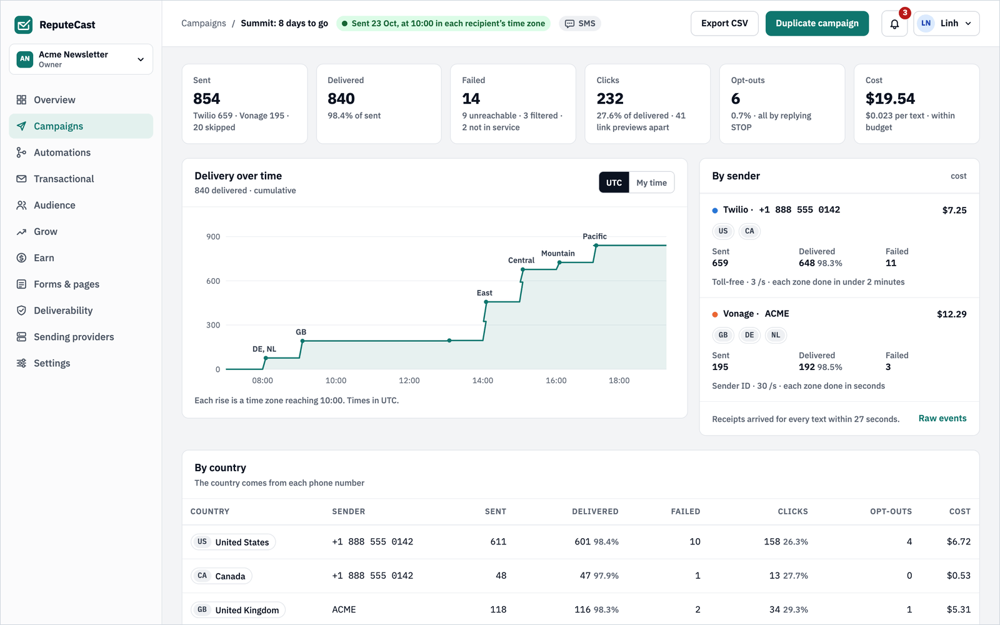
      <b>SMS campaigns</b> that send at local time, with results per country.
    </td>
  </tr>
</table>

<details>
<summary>More screenshots</summary>
<br>

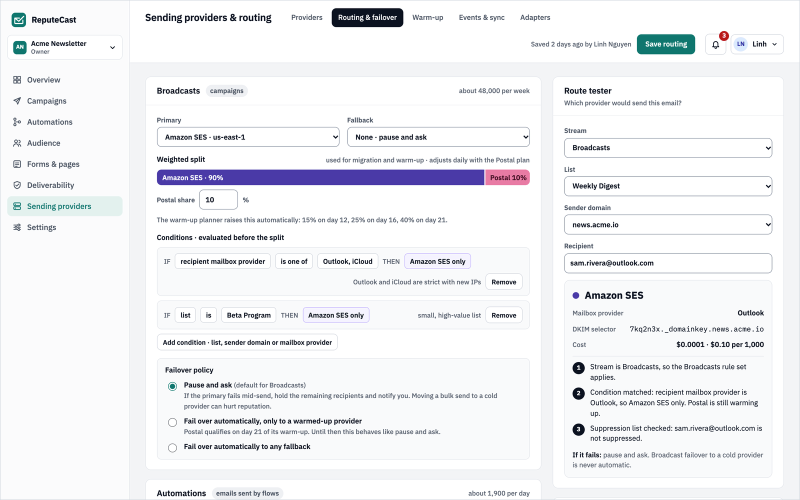
<p><b>Routing</b> across providers, with weighted splits, failover and a route tester.</p>

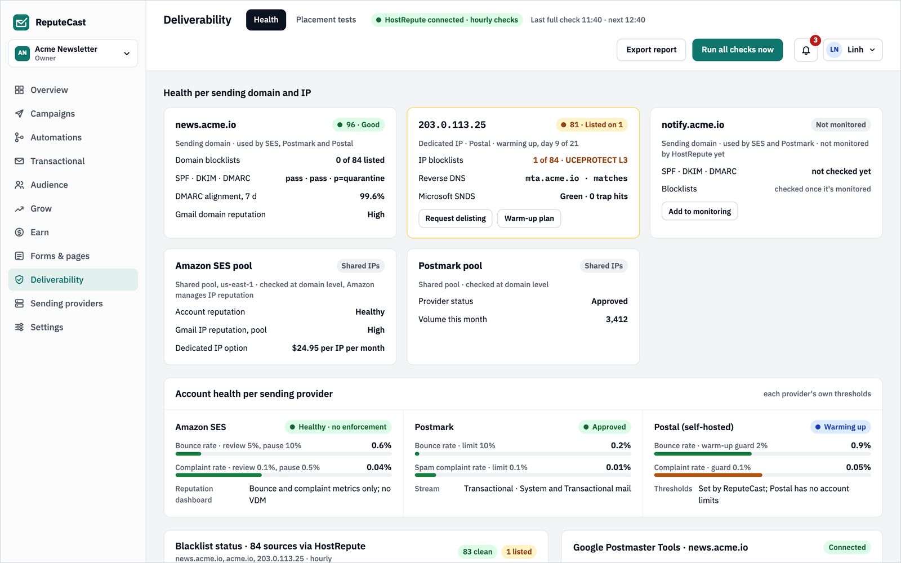
<p><b>Deliverability:</b> health per sending domain and IP, and each provider's account health.</p>

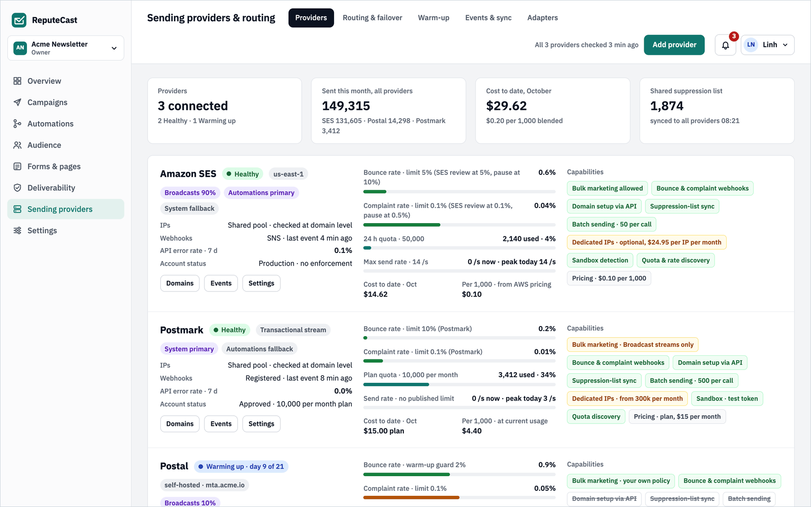
<p><b>Sending providers:</b> health, quotas, costs and what each provider supports.</p>

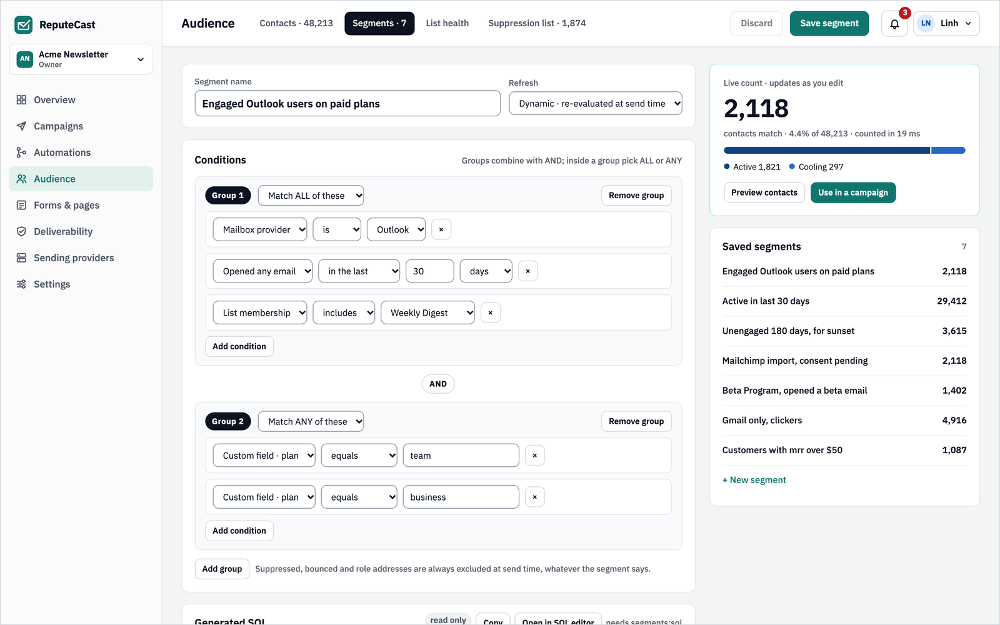
<p><b>Segments:</b> AND/OR condition groups with a live count.</p>
</details>

## Quick start

You need Docker with Compose:

```bash
curl -fsSL -o docker-compose.yml \
  https://raw.githubusercontent.com/hostrepute/reputecast/main/deploy/docker-compose.yml
REPUTECAST_ADMIN_EMAIL=you@example.com docker compose up -d
docker compose logs app | grep -A4 "ReputeCast is installed"
```

Open <http://localhost:8080> and sign in with the temporary password from the
logs. ReputeCast then walks you through securing your account and connecting a
sending provider.

For a server with a domain and TLS, or to run the release binary, follow the
[self-hosting guide](docs/deploy/README.md). To explore the Acme demo data
from a checkout, see [CONTRIBUTING.md](CONTRIBUTING.md#development-setup).

## Documentation

- [Self-hosting](docs/deploy/README.md): Docker, the binary, commands, upgrades, backups and scaling
- [Configuration](docs/deploy/configuration.md) · [Reverse proxy and TLS](docs/deploy/reverse-proxy.md) · [Postgres](docs/deploy/postgres-tuning.md)
- [API, webhooks and MCP](docs/api/README.md)
- [Integrations](docs/integrations/hub.md): the Zapier, Make and n8n apps and the WordPress plugin in `integrations/`
- [Sending provider adapters](docs/adapters.md) · [HostRepute integration](docs/integrations/hostrepute.md)
- [How it works and the security model](docs/architecture.md)
- [Translating ReputeCast](docs/i18n/translating.md)
- [Roadmap](docs/ROADMAP.md)

## Contributing

Issues, discussions and pull requests are welcome. [CONTRIBUTING.md](CONTRIBUTING.md)
explains how to set up the development environment and what a change needs.
Please follow the [Code of Conduct](CODE_OF_CONDUCT.md), and report security
problems privately as described in [SECURITY.md](SECURITY.md).

## License

ReputeCast is licensed under the [GNU Affero General Public License v3.0](LICENSE).
It is built by [HostRepute](https://hostrepute.com) and works with or without a
HostRepute account.
